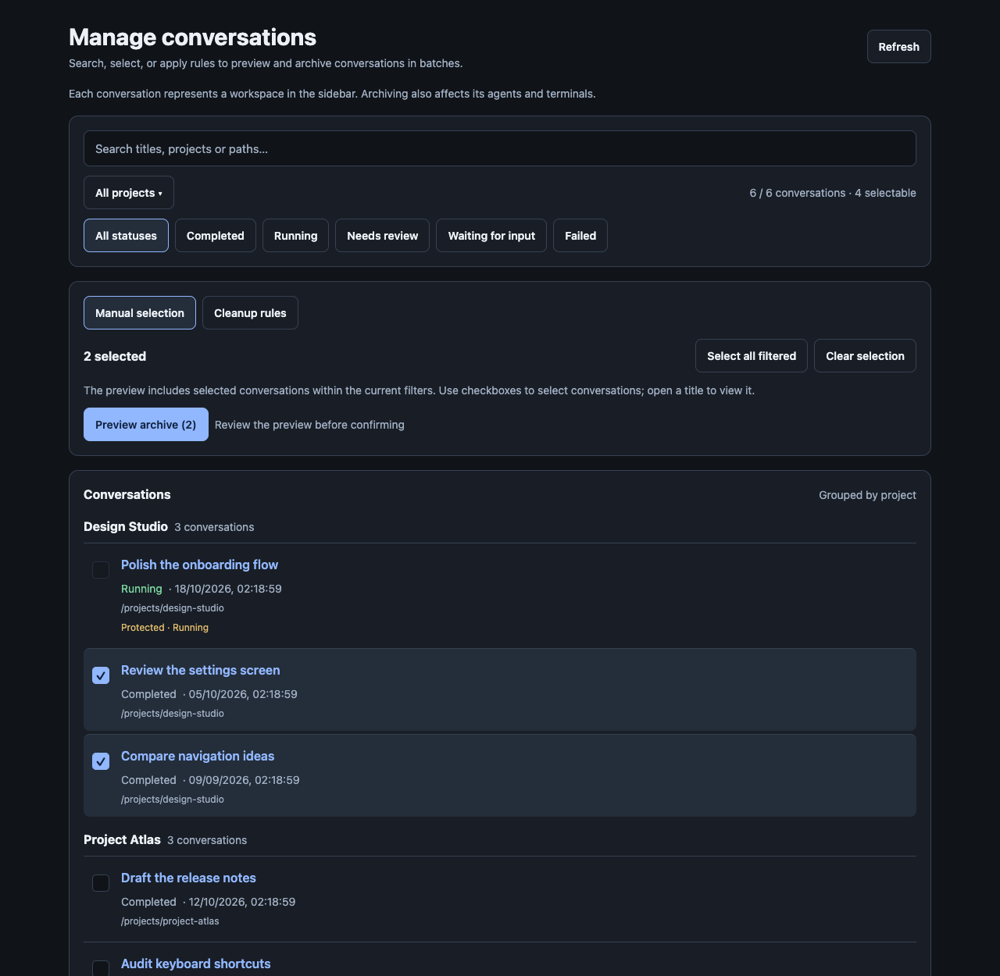
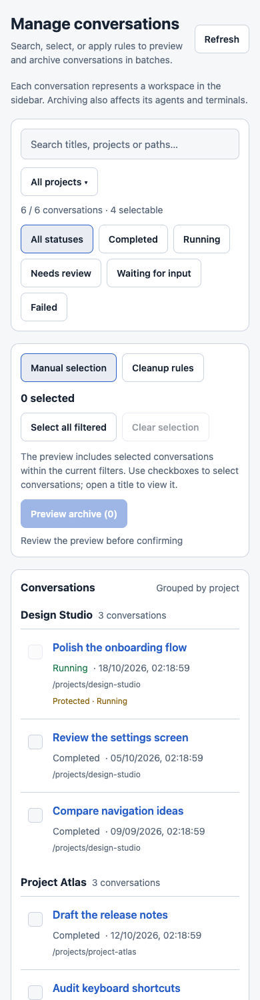

# Paseo Conversation Manager

A community Paseo plugin for searching, filtering and batch archiving conversations from a dedicated sidebar screen. Select conversations manually, or preview rules based on activity age and the number to keep per project.



## Installation

Requires Paseo app and daemon `>=0.11.4 <0.12.0`. Install directly from the public GitHub repository:

```sh
paseo plugin add git:sunnypsk/paseo-conversation-manager --ref v0.1.1
```

Open **Manage conversations** in the sidebar or Command Center. No API keys, accounts or additional runtime dependencies are required. Paseo supplies the plugin's host libraries, so no preparation command is needed.

The plugin ID is `conversation-manager`. Existing local installations keep this ID and their host-specific settings. Registry installation becomes available after Paseo's registry review; direct GitHub installation does not require a listing.

## Features

- Search conversation titles, project names and paths; filter by project and status.
- Select individual conversations or all eligible conversations in the current filters.
- Preview archive candidates before confirming a batch.
- Archive conversations inactive for a specified number of days, keep the latest N per project, or combine both rules.
- Review archived, skipped and failed results individually.
- Optionally enable host-specific automatic cleanup after completed agent turns.

Manual selection is the default. Automatic cleanup remains off until you save and enable it. It responds to completed turns rather than a clock schedule; failed and canceled turns do not trigger it.

Per-project retention ranks the complete project by activity, regardless of search and status filters. When both age and count rules are enabled, a candidate must satisfy both. Protected conversations with known activity count toward retention; conversations with unknown activity are kept without using a retention slot.

## Archive behavior and data access

Each conversation represents a sidebar workspace, including its agents and terminals. Archiving closes those resources. Previews expire after five minutes, freeze candidate IDs and can be used only once. The plugin checks current activity and eligibility again before each archive.

Running, initializing, waiting-for-input, pinned and archiving conversations, running workspace services, unknown activity and worktrees are protected. Use Paseo's native archive flow for worktrees, because archiving can remove their backing directories. There is no direct undo operation in the public SDK, and a request already sent to Paseo cannot be canceled by this plugin.

The plugin reads workspace and agent metadata from the selected Paseo host, stores cleanup preferences on that host and calls its archive API. It does not read message bodies, call an LLM or send data to third-party services. Recent results are kept in memory and clear on plugin reload; preferences persist. See [OVERVIEW.md](OVERVIEW.md) for the in-app listing.

Plugin-owned UI, settings, accessibility text, errors and documentation are in English. User-provided conversation titles, project names and paths retain their original text. The interface supports desktop and compact layouts; physical iOS/Android testing has not been completed.

<details>
<summary>Compact layout with sample data</summary>



</details>

## Development

Use Node.js 22 or later:

```sh
git clone https://github.com/sunnypsk/paseo-conversation-manager.git
cd paseo-conversation-manager
npm ci --ignore-scripts
npm run typecheck
npm test
paseo plugin install /absolute/path/to/paseo-conversation-manager
```

After editing, run the checks and `paseo plugin reload conversation-manager`. A daemon restart is not required.

The source contains a shared retention planner, a daemon-side preview/execution engine and a React Native screen. Tests exercise fake Paseo APIs without archiving real user workspaces. See [VERIFICATION.md](VERIFICATION.md) for verification evidence and limits, and [Paseo's publishing guide](https://paseo.sh/docs/plugins/publishing) for Git and registry distribution.
